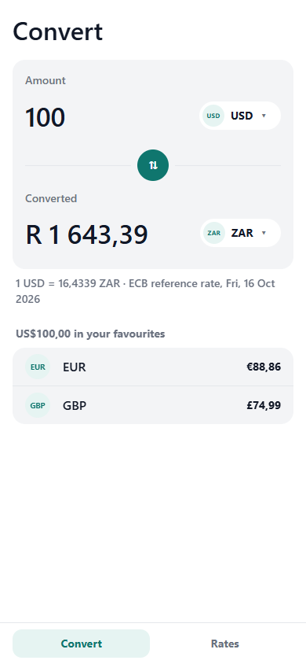
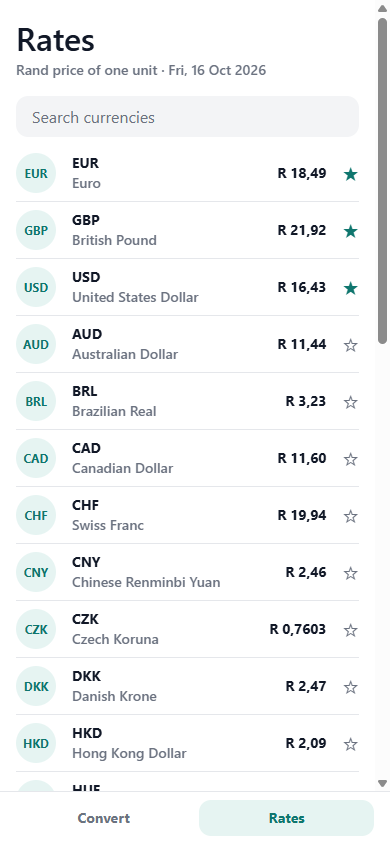
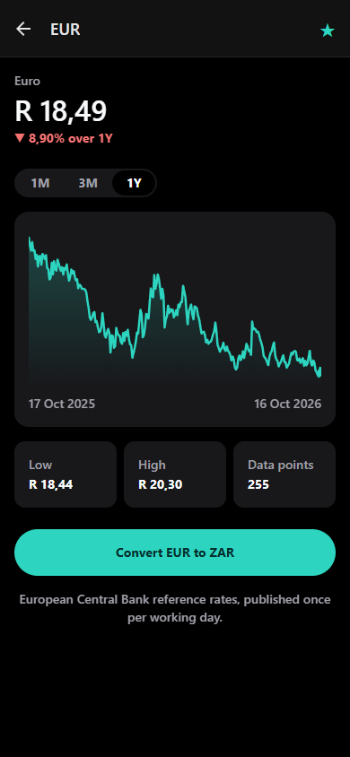
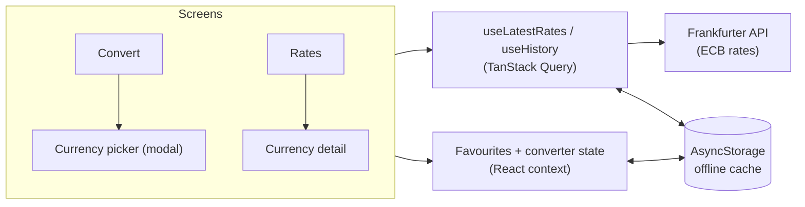

# Rand Rates

[](https://github.com/Pierce-Robinson/rand-rates/actions/workflows/ci.yml)

A currency converter for South Africans, built with **React Native, Expo and TypeScript**. Live European Central Bank rates, conversions to and from the rand, favourites, history charts and offline support, on iOS, Android and the web.

**Try it in your browser: [pierce-robinson.github.io/rand-rates](https://pierce-robinson.github.io/rand-rates/)**

<p>
  
  
  
</p>

## Features

- **Convert** between any two of 30 currencies, with the rand as the home currency
- **Rates list** showing the rand price of each currency, with search, pull to refresh and favourites first
- **History charts** for 1 month, 3 months or 1 year, with change, low and high
- **Works offline**: the last rates are saved on the device and shown with a clear "offline" notice
- **Favourites** saved on the device, with a quick comparison of any amount across them
- **South African formatting** throughout: R 1 643,39, decimal commas, and amounts typed as "1 500,50" or "1,500.50"
- **Light and dark mode**, accessible labels on every control, and a layout that also works on tablets and desktop browsers

## Tech stack

| | |
| --- | --- |
| App | React Native 0.88, Expo SDK 58, TypeScript, React Compiler |
| Navigation | Expo Router: native tabs (iOS and Android system tab bars), a stack, and a modal picker |
| Data | TanStack Query with an AsyncStorage persister for offline caching; NetInfo for connection status |
| Charts | Hand-drawn SVG with react-native-svg (no charting library) |
| API | [Frankfurter](https://frankfurter.dev): free, key-less European Central Bank reference rates |
| Testing | Jest (jest-expo) and React Native Testing Library: 36 tests |
| Delivery | GitHub Actions: lint, typecheck and tests, then automatic deploy of the web build to GitHub Pages |

## How it's built



| Decision | Why |
| --- | --- |
| Every data screen designs four states: loading, error, empty and content | A failed refresh keeps showing saved data with a retry banner instead of a blank screen |
| Query cache persisted to device storage | Rates load instantly on launch and still work with no signal |
| Rates quoted against the rand, shown as rand per unit | "1 USD = R 16,43" is how people here think about exchange rates |
| Pure functions for conversion, parsing and chart geometry | The fiddly logic is unit tested without rendering anything |
| Native tabs on iOS and Android, a custom tab bar on web | Each platform gets the navigation people expect |
| A hand-rolled SVG chart | Keeps the app small and works in Expo Go, on native and on the web |

## Running it

```bash
npm install
npx expo start
```

Scan the QR code with **Expo Go** on your phone (iPhone or Android), or press `w` to open it in a browser. No API key or account is needed.

```bash
npm test           # Jest + React Native Testing Library
npx tsc --noEmit   # typecheck
npx expo lint      # lint
```

## Project structure

```
src/
  app/          Expo Router routes only: (tabs)/index, (tabs)/rates, currency/[code], pick-currency
  screens/      Screen bodies rendered by the routes
  components/   Reusable UI: chart, rows, banner, segmented control
  hooks/        Data hooks (TanStack Query), network status, theme
  state/        Query client and persistence, favourites, converter state
  api/          Frankfurter API client
  utils/        Conversion, parsing, formatting, chart geometry, search (with colocated tests)
```

## License

[MIT](LICENSE). Exchange rates are European Central Bank reference rates via Frankfurter and are for information only.
